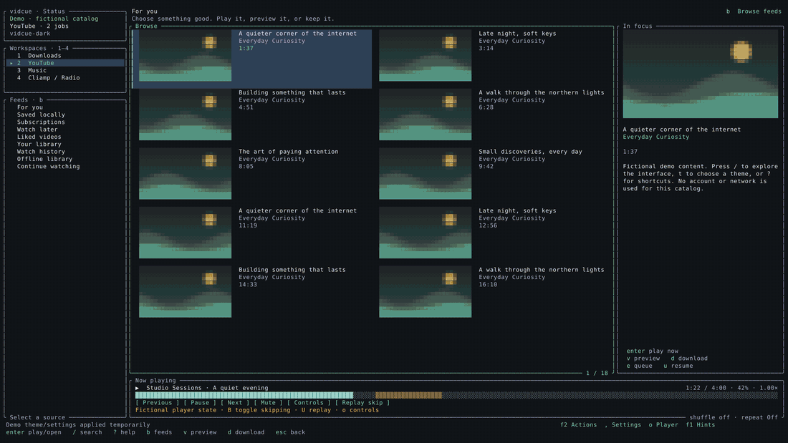
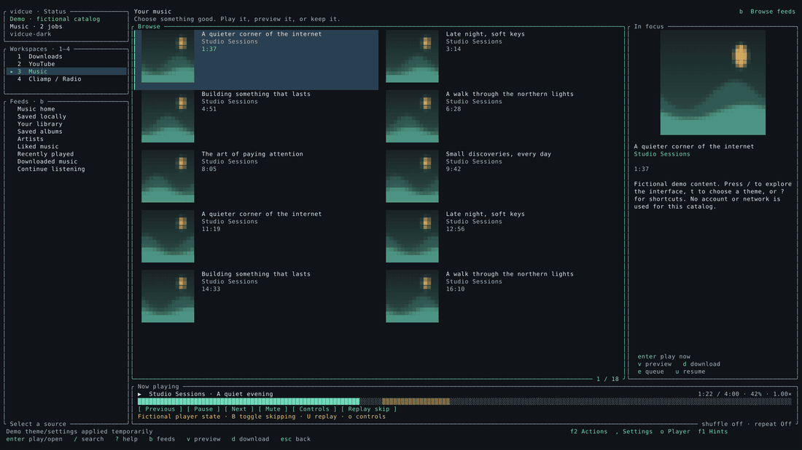
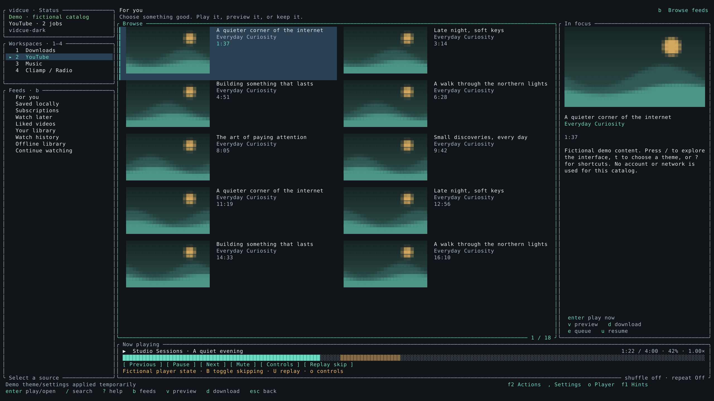
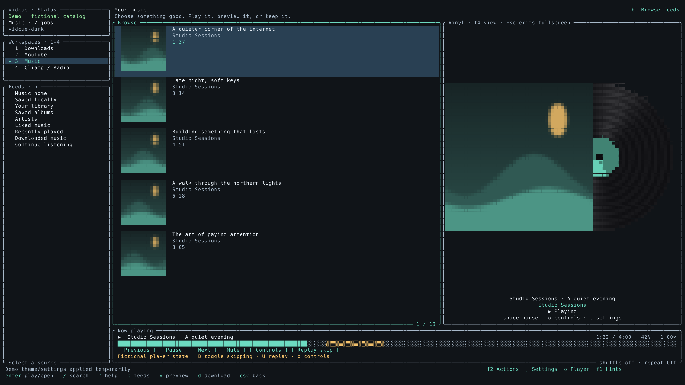
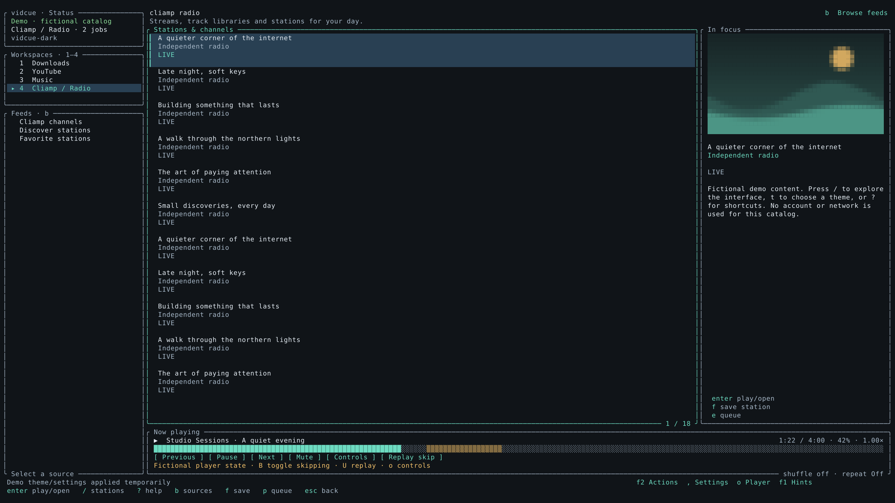
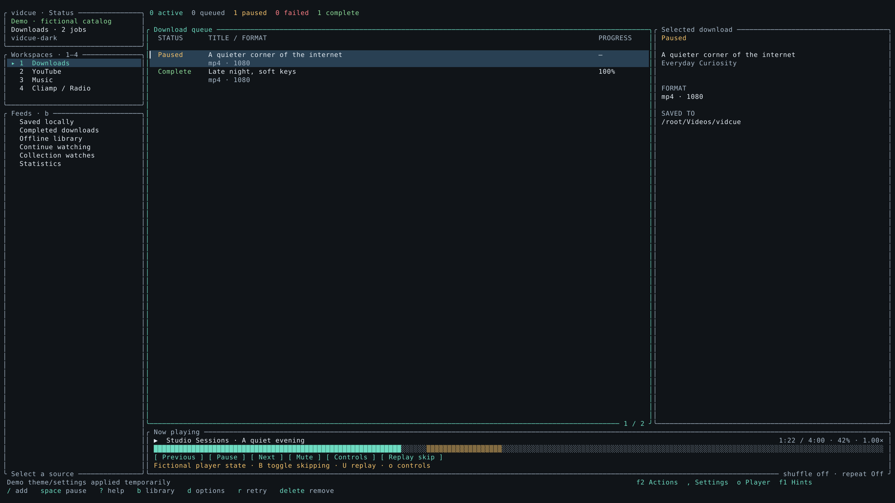
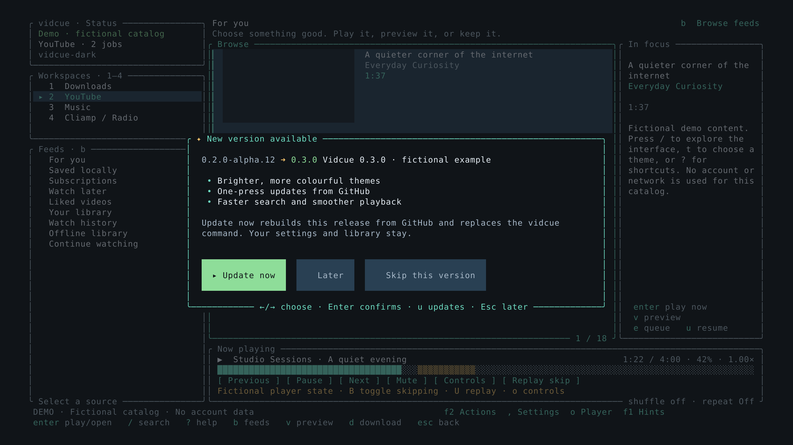
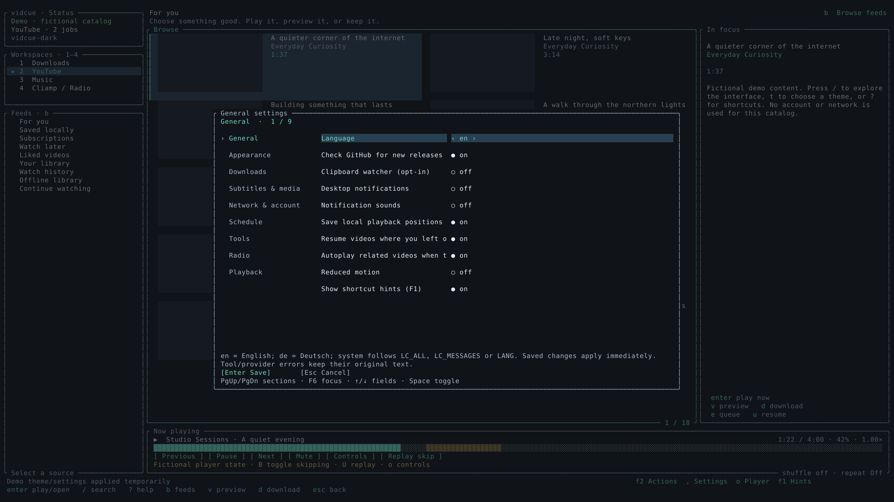
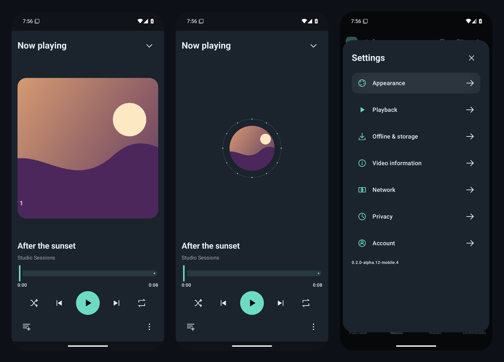

<p align="center">
  
</p>

<p align="center">
  <a href="#-install"></a>
  <a href="docs/android/README.md"></a>
  
  
  <a href="LICENSE"></a>
</p>

<h3 align="center">🎬 Watch &nbsp;·&nbsp; 🎧 Listen &nbsp;·&nbsp; 📻 Tune in &nbsp;·&nbsp; ⬇️ Keep it</h3>

<p align="center">
A fast, keyboard-first app for <b>YouTube</b>, <b>YouTube Music</b>, <b>internet radio</b> and <b>downloads</b>.<br>
Lazygit-style panes and mpv on the desktop · a native touch app on Android · one shared Rust engine.
</p>

> [!NOTE]
> **ytui is now Vidcue.** Your settings, queues, history and downloads move over automatically,
> and the old `ytui` command keeps working.

---

## ✨ Highlights

| | |
|---|---|
| 🎬 **Videos in mpv** | Native Rust playback, resume where you left off, SponsorBlock skip or mark. |
| 👀 **Quick previews** | Press `v` for a short, muted preview before you commit. |
| 🎧 **Four music players** | Classic, spinning vinyl, Neon VU and Pulse Orbit, each pane or fullscreen. |
| 📻 **Radio** | Thousands of stations, pinned countries, optional cliamp. |
| ⬇️ **Downloads** | Videos, audio, whole playlists, subtitles, chapters and per-file retry. |
| 🎨 **15 themes** | Follows Omarchy or Caelestia, or pick Tokyo Night, Catppuccin, Gruvbox and more. |
| 🔔 **One-press updates** | A popup tells you about a new release; **Update now** installs it. |
| 📱 **Android** | Jetpack Compose UI for phones and tablets on the same Rust engine. |

## 🎨 Every theme, one keypress

<p align="center"></p>

Press `t` for the theme picker. `system` follows your desktop theme (Omarchy, Caelestia, GNOME).

## 🎧 Players that move with the music

<p align="center"></p>

`F4` cycles **classic → vinyl → Neon VU → Pulse Orbit**. `Esc` leaves fullscreen.

## 🖼️ A closer look

<table>
  <tr>
    <td width="50%"><p align="center"><b>📺 YouTube</b>: feeds, search, details</p></td>
    <td width="50%"><p align="center"><b>💿 Music</b>: the vinyl player</p></td>
  </tr>
  <tr>
    <td><p align="center"><b>📻 Radio</b>: stations worldwide</p></td>
    <td><p align="center"><b>⬇️ Downloads</b>: jobs, files, retries</p></td>
  </tr>
  <tr>
    <td><p align="center"><b>🔔 Updates</b>: one press</p></td>
    <td><p align="center"><b>⚙️ Settings</b>: grouped by topic</p></td>
  </tr>
</table>

<sub>All screenshots use the fictional demo catalog (<code>vidcue --demo</code>). No real account is shown.</sub>

## 📱 Android

<p align="center"></p>

<p align="center">
  <a href="https://github.com/Vanir20342222/ytui/releases"></a>
  &nbsp;
  <a href="docs/screenshots/android/README.md"></a>
</p>

<sub>Beta.1 starts a new app installation alongside older alphas. Every subsequent beta, RC and final release updates that beta in place; About → Check for updates offers new versions. This is an early testing release. See the [beta notes](docs/android/BETA1_RELEASE.md) and [Android notes](docs/android/README.md).</sub>

## 🚀 Install

You need stable Rust, a C compiler, pkg-config, OpenSSL headers, **mpv** and **FFmpeg**.
Node.js 22+ (or Deno 2.9.7) speeds up native playback.

```bash
# Arch / CachyOS / Omarchy
sudo pacman -S --needed base-devel rustup openssl mpv ffmpeg nodejs
rustup default stable

git clone https://github.com/Vanir20342222/ytui.git vidcue
cd vidcue && ./install.sh
vidcue doctor   # check tools and settings
vidcue          # start
```

`./install.sh` puts `vidcue` in `~/.local/bin`, keeps `ytui` and `ytui-rs` as aliases, and saves the
previous build as `vidcue.previous` (`tools/rollback-install.sh` switches back).

### 🔄 Staying up to date

- Vidcue checks GitHub when it starts and shows a popup when a newer release exists.
- **Update now** downloads that release, builds it and installs it. **Skip this version** stays quiet until the next one.
- Check any time with `F2 → Check for a new Vidcue version`, or run `vidcue update` (`--check` only reports).
- Turn the check off in `,` → **General** → *Check GitHub for new releases*.

## ⌨️ Keys you'll use most

| Key | Does |
|---|---|
| `1` `2` `3` `4` | Downloads · YouTube · Music · Radio |
| `/` · `b` | Search · browse feeds |
| `Enter` · `v` · `d` | Play · quick preview · download |
| `Space` · `o` · `p` | Pause · player controls · queue |
| `F4` | Next music player style |
| `S` · `u` | Save locally · resume list |
| `t` · `,` · `F2` | Themes · settings · all actions |
| `?` · `F1` | Help · show or hide hints |

## 🧰 Handy commands

```bash
vidcue --demo                  # fictional catalog, no account or network
vidcue --offline               # your local library only
vidcue doctor --network        # test public YouTube, Music and radio access
vidcue playback-check URL      # play 3 seconds with mpv and report
vidcue migrate [--apply]       # import settings from the old Python app
vidcue update [--check]        # install (or just look for) a new release
```

<details>
<summary><b>🎬 Playback details</b></summary>

Playback defaults to **native Rust**, using pinned
[yt-dlp-rs](https://github.com/aagedal/yt-dlp-rs). Installed Node.js 22+ (or Deno
2.9.7) solves its offline JavaScript challenges. Playback preserves native stream
headers, accepts HLS manifests and refreshes an interrupted native URL once.
It never starts Python automatically in native mode. **Settings → Playback →
Playback backend** selects native, auto or external yt-dlp; downloads keep their
separate `auto` default. Install `yt-dlp` yourself if you choose fallback or external
extraction. Existing explicit playback choices are kept.

Live access still depends on the account and network; a 99% watching success rate is
**not established**. See [current playback evidence](docs/SINGLE_VIDEO_SWEEP.md),
[CI diagnosis](docs/CI_PLAYBACK_DIAGNOSIS.md) and
[playback/playlist fixes](docs/PLAYBACK_REPAIR.md).

- Videos continue where you left off (toggle in General settings; `:player-seek 0` starts over).
  Music and stations start from the top.
- `B` toggles SponsorBlock skipping and `U` replays a skipped part; Settings → Playback
  chooses categories and skip / mark / off.
- `o → Set sleep timer` stops playback after e.g. `30m` and keeps the queue.
- `g` in mpv opens its window menu. Volume and mute persist.
</details>

<details>
<summary><b>⬇️ Downloads and feeds</b></summary>

- Playlist links download whole collections; watch links with playlist context stay
  single-video unless you expand them. Collection jobs keep their source across retries,
  and `auto` uses yt-dlp for native playlist limits.
- Downloads keep valid outputs after malformed later records and reject empty files.
- `F2 → Downloads` shows individual jobs, per-entry retry and files, and recent folders.
- Feeds load more near the end and recover from temporary errors without losing your place.
  Thumbnails use sized memory and disk caches with nearby prefetch.
- `F2 → Account` imports a selected local browser session. Personal feeds need sign-in;
  anonymous Home may have no recommendations.
</details>

<details>
<summary><b>🖥️ Desktop targets and status</b></summary>

Omarchy + Ghostty + Brave Origin is the current desktop target; CachyOS and Caelestia
remain compatibility targets. This is the **0.2.0-alpha.12 candidate**
([audit fixes and acceptance](docs/AUDIT_IMPLEMENTATION.md)).
[Local acceptance](docs/LOCAL_ACCEPTANCE_2026-10-26.md) records verified target-PC
playback, account and desktop cases; [remaining work](docs/REMAINING_WORK.md) tracks
broader service and device acceptance and unsupported features.
</details>

<details>
<summary><b>🧪 Development</b></summary>

```bash
cargo fmt --all -- --check
cargo clippy --workspace --all-targets --locked -- -D warnings
cargo test --workspace --locked
tools/test-youtube.sh auto     # opt-in live public checks
```

[Live test instructions](docs/LIVE_YOUTUBE_TESTS.md) describe the tools, fixture URLs and CI runner.

Regenerate the WQHD screenshots with the real executable and fictional content:

```bash
cargo build -p vidcue --locked
cargo run -p vidcue --example capture_ui --locked -- --binary target/debug/vidcue
cargo run -p vidcue --example capture_update --locked -- docs/screenshots/update-popup.png
```

A monospaced TTF font is required; pass `--font /path/to/font.ttf` if DejaVu Sans Mono
lives elsewhere. The README GIFs are built from those screenshots with FFmpeg.

The repository is a Rust monorepo: `apps/desktop` (terminal app), `apps/android`
(Compose UI), `crates/vidcue-core`, `vidcue-services`, `vidcue-providers` and
`vidcue-mobile` (Android engine).
</details>

## 📚 Docs

[Documentation index](docs/README.md) · [Usage and settings](docs/RUST.md) · [Theme gallery](docs/UI_THEMES.md) ·
[Android](docs/android/README.md) · [Remaining work](docs/REMAINING_WORK.md) · [Validation](docs/VALIDATION.md) ·
[Feature audit](docs/FEATURE_AUDIT.md) · [Rewrite plan](RUST_REWRITE_PLAN.md)

<p align="center"><sub>MIT licensed · <a href="THIRD_PARTY_NOTICES.md">third-party notices</a> · made for people who live in the terminal 💜</sub></p>
