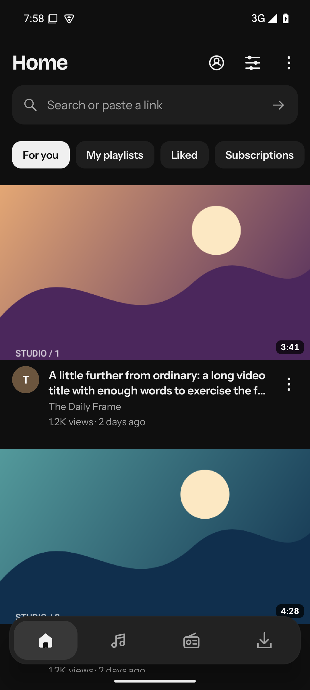
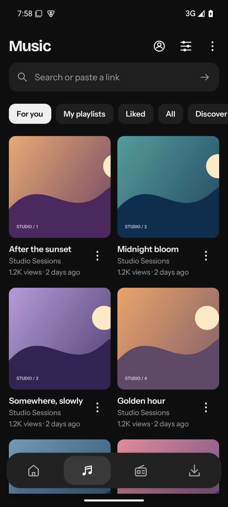
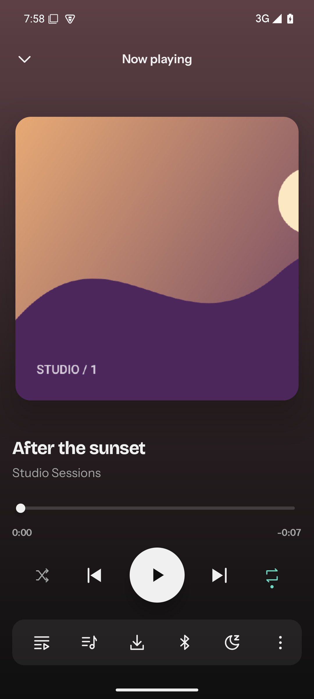
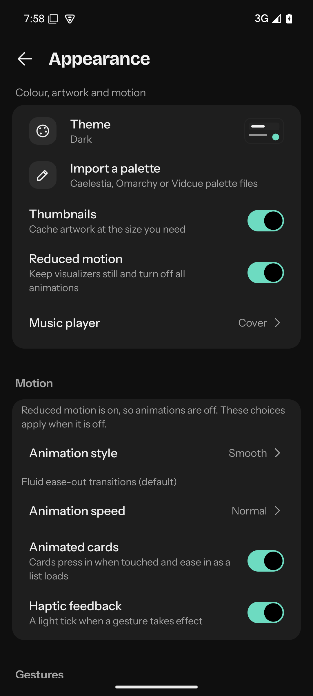
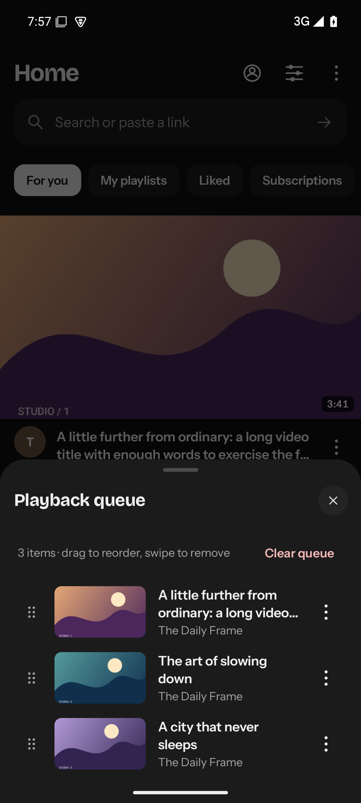
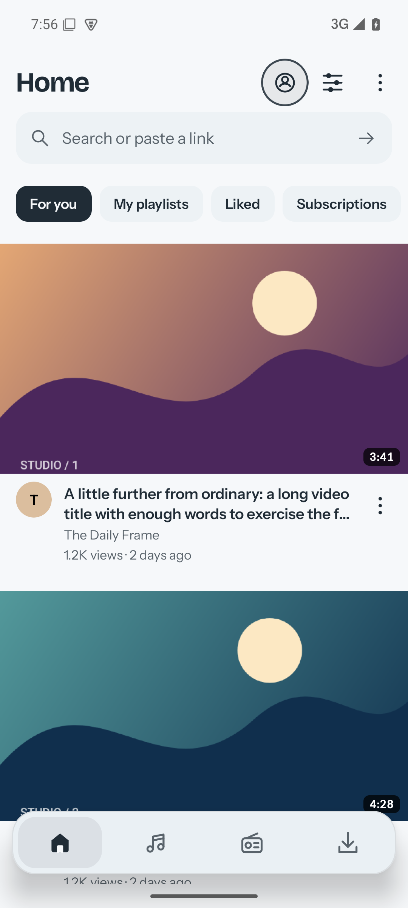
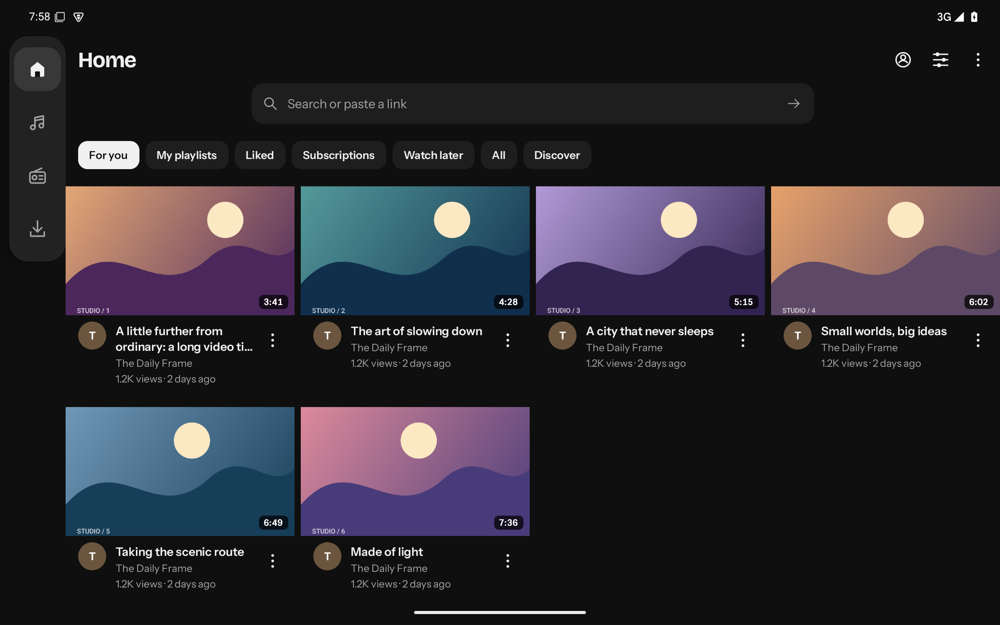

# Vidcue for Android

**Vidcue** is a native Android app for watching and listening to **YouTube**, **YouTube Music** and **internet radio**, with background playback and offline downloads. The UI is Jetpack Compose; media playback uses Media3; the network, catalog and extraction engine is shared Rust (`crates/vidcue-mobile` compiled through JNI). No Python and no mpv executable runs on Android, and the explicit account sign-in page is the app's only WebView.

This repository is the Android app plus the shared Rust backend crates it builds on. A future desktop application will reuse the same backend; the old terminal UI has been removed.

> [!NOTE]
> **ytui is now Vidcue.** Older documentation and release notes may still say ytui.

## Install

Download a signed APK from the [releases page](https://github.com/Vanir20342222/ytui/releases), open it in Android Files and allow installation from that source. The current beta channel installs the permanent package `dev.vidcue.android.stable` (Android 8 / API 26+, ARM64 and x86-64); later betas and final releases update that installation in place. Debug CI artifacts are the separate **Vidcue Preview** app.

Details, release qualification records and the feature walkthrough live in [`docs/android/README.md`](docs/android/README.md).

## Screens

Actual emulator captures of the current beta (see [docs/screenshots/android/2026-11-08/](docs/screenshots/android/2026-11-08/README.md)):

<p align="center">
  
  &nbsp;
  
  &nbsp;
  
</p>

<p align="center">
  
  &nbsp;
  
  &nbsp;
  
</p>

<p align="center">
  
</p>

## Build from source

Requirements: Rust (see `rust-toolchain.toml`), the [Android SDK](https://developer.android.com/studio) with `ANDROID_HOME` set, and NDK `27.2.12479018` (or point `ANDROID_NDK_HOME` at an installed NDK).

```sh
tools/android/build.sh            # debug APK
YTUI_ANDROID_VARIANT=release tools/android/build.sh   # needs signing env; see docs/android/SIGNING.md
```

The script builds the Rust engine for each ABI, then packages the Gradle app. It installs nothing on the host or on a device.

## Repository layout

| Path | What it is |
|---|---|
| `apps/android` | Native Jetpack Compose Android app (Kotlin/Java UI, activity, media and storage adapters) |
| `crates/vidcue-mobile` | Android's Rust engine: JNI bridge, native playback and catalog worker |
| `crates/vidcue-providers` | Shared YouTube/Music/radio provider and extraction logic |
| `crates/vidcue-services` | Shared backend services: playback state, downloads, library, storage |
| `crates/vidcue-core` | Shared data model: media, queue, history, settings |
| `vendor/yt-dlp-rs` | Patched vendored extractor used by the native engine |
| `tools/android` | Android build, signing, release and device-test tooling |
| `tools/ci` | CI path filters and PR checks |
| `docs/android` | Android plan, parity gates, validation and release records |

## Status

This is an early beta: real-network latency, audio output on more devices, physical-device in-place updates and the remaining [parity gates](docs/android/PARITY.md) are still open. Current validation evidence is recorded in [`docs/android/VALIDATION.md`](docs/android/VALIDATION.md) and [`docs/changes/`](docs/changes/).

## License

MIT — see [LICENSE](LICENSE). Third-party notices are generated at build time (`crates/vidcue-mobile/examples/mobile_license_bundle.rs`) and bundled in the app.
