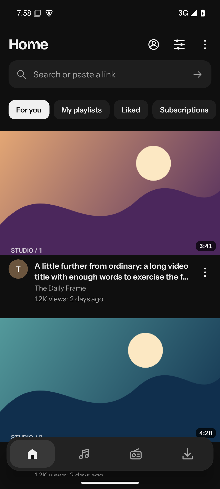
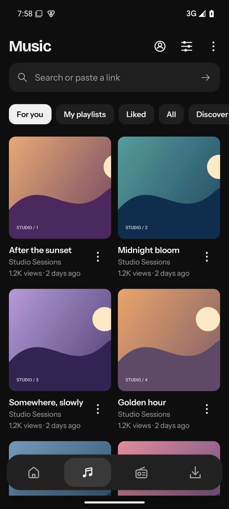
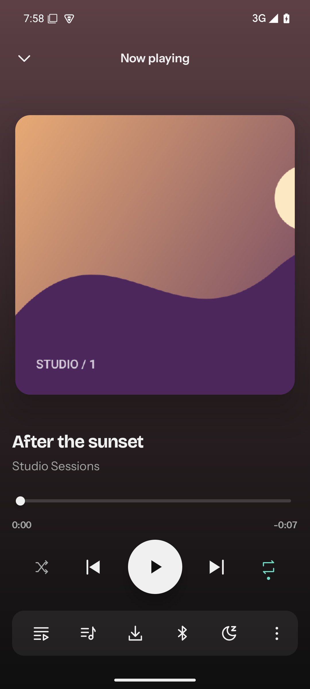
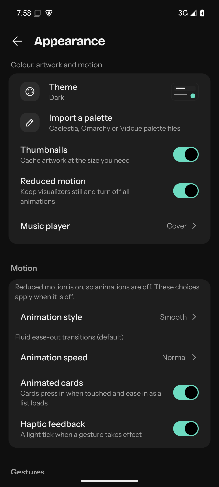
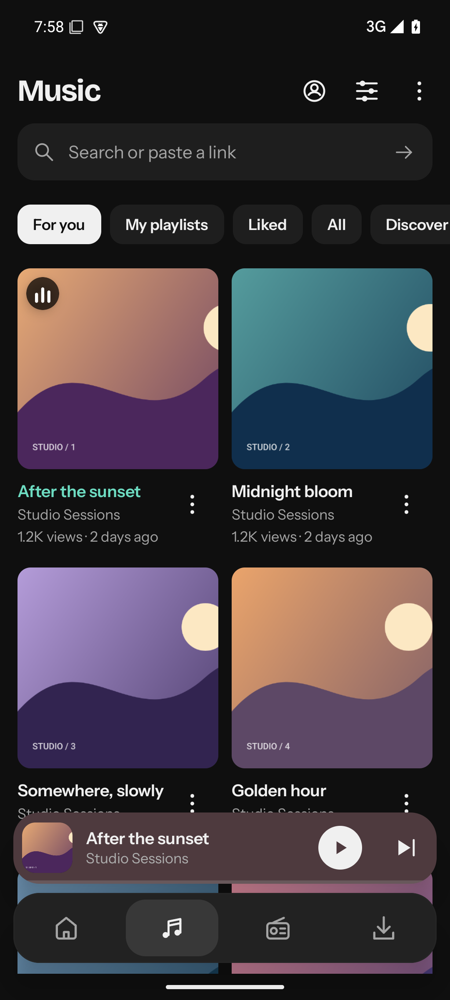
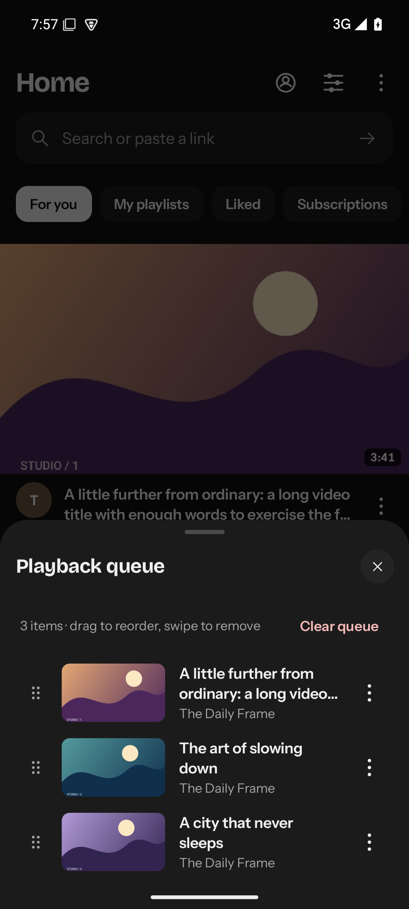
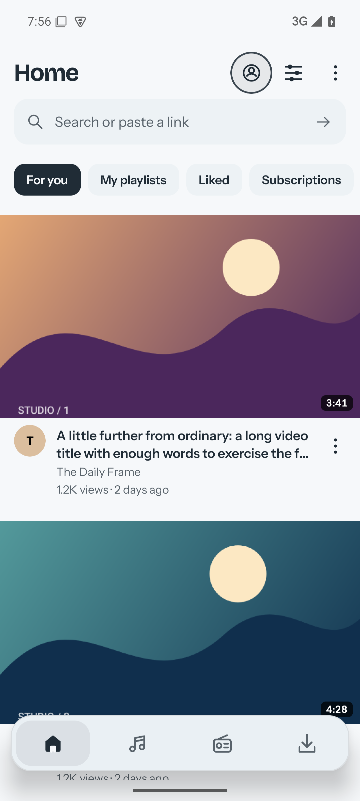
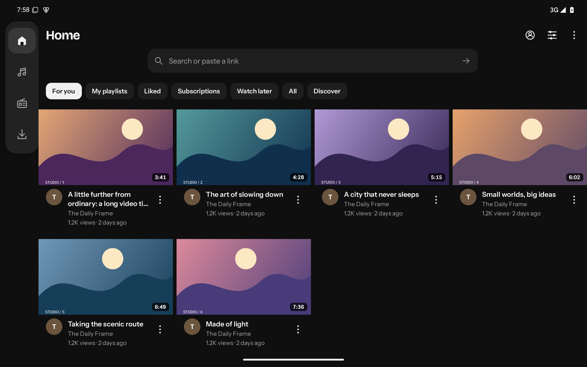

# Android beta UI (2026-11-08 captures)

Actual unedited API 35 emulator captures from commit `53c2f98`, taken on a local
headless emulator (NVIDIA GTX 1050 Ti host GPU, KVM). Catalog artwork and media are
original generated offline fixtures, not a personal account or a live feed. No
capture has been cropped, resized or retouched.

See `manifest.json` for the run configuration and instrumentation result.

  

  

 

Emulator rendering does not establish audible output or physical-device/live
YouTube acceptance; those gates remain open in [docs/android/PARITY.md](../../android/PARITY.md).
The older [mobile.4 alpha gallery](../README.md) documents a superseded UI.
